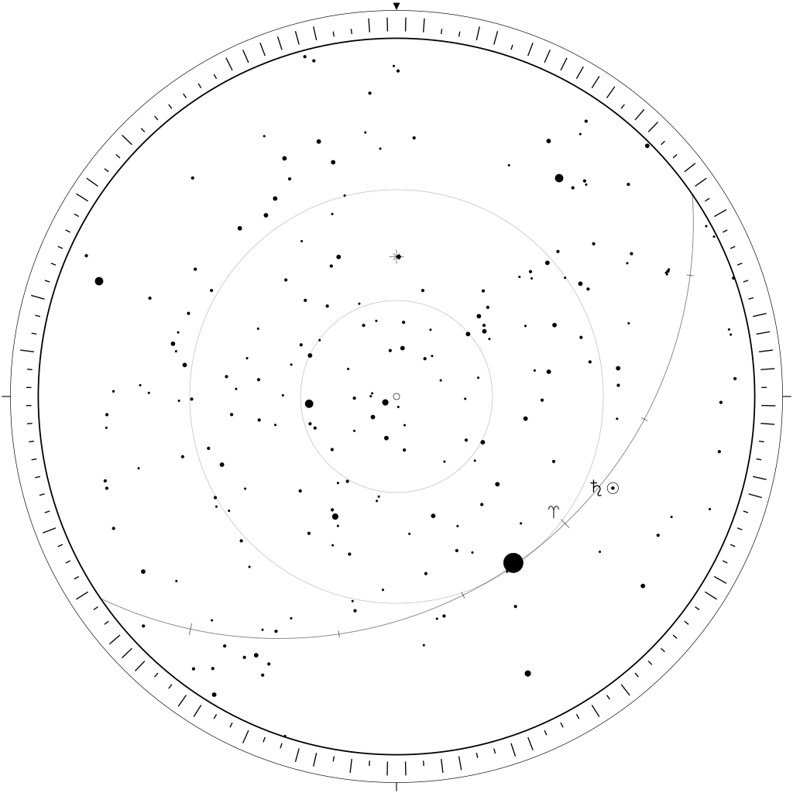

# starhash

A time-and-place signature for documents and artifacts, written as the sky.

<p align="center"></p>

Starhash takes a place, a time and a file, and produces a **seal**: a monochrome SVG of the sky as it stood over that place at that moment, with the file's hash bound to it. The seal can be checked against the file, and the place and time can be read back out of the drawing itself, with no key and no label, by anyone who knows the stars.

```bash
starhash sign contract.pdf --lat 47.3769 --lon 8.5417
starhash verify contract.pdf.seal.svg contract.pdf
starhash read contract.pdf.seal.svg
```

It has no runtime dependencies.

## Sealing a document

```bash
starhash sign contract.pdf --lat 47.3769 --lon 8.5417 --elevation 400
```

```
Sealed  contract.pdf
  at    47.37690°N 8.54170°E, 400 m
  on    2026-08-28T22:00:00Z
  seal  contract.pdf.seal.svg
  id    STARS-Ja6g-a7RJ-rtyh-erHa-Fn76-6q
```

The time defaults to now; pass `--date 2026-08-28T22:00:00Z` (UTC unless an offset is given) to seal for another moment. To avoid typing your position each time, set `STARHASH_LAT`, `STARHASH_LON` and optionally `STARHASH_ELEVATION`. `-o` chooses where the seal is written.

The seal has three layers:

- the **sky** inside the horizon circle, north at the top marked by a wedge, which carries the place and time;
- a **ring of 128 ticks** around the horizon, which carries the document: read clockwise from north, a long tick is 1 and a short tick is 0, spelling the first 128 bits of the file's SHA-256;
- an invisible `<metadata>` record with the exact place and time, the full SHA-256 and a short id over all of them.

The first two layers are the drawing itself, so they survive when the record is stripped or the seal is printed. Coordinates are kept to five decimals (about a metre) and time to the second, so the same inputs always give the same seal, byte for byte.

### What each mark means

Every mark in the drawing carries information; none is ornament. There is no text and no font.

| Mark | Meaning |
| --- | --- |
| Heavy circle | the horizon |
| Small ring at the centre | the zenith, the point overhead |
| Two faint circles | altitudes of 60° and 30°, which give the scale of the projection |
| Wedge on the rim; three strokes | north; east, south and west |
| Dots in five sizes | stars, by brightness |
| Small eight-armed cross | the celestial pole; its height above the horizon is the latitude |
| Curved line | the ecliptic, the path of the Sun, Moon and planets |
| Strokes across it | the twelve signs, every 30°, longer at the equinoxes and solstices |
| Ram's horns | the vernal point, where the count of signs begins; its slow drift among the stars marks the century |
| Disc, part filled | the Moon and its phase, turned towards the Sun |
| Ringed point with a sign | a planet |
| Ring with a centre point, heavier | the Sun |
| Ticks in the rim | the document: 128 bits, clockwise from north, long for 1 |

## Checking a seal

```bash
starhash verify contract.pdf.seal.svg contract.pdf
```

```
Seal STARS-Ja6g-a7RJ-rtyh-erHa-Fn76-6q
  claims 47.37690°N 8.54170°E on 2026-08-28T22:00:00Z
  for    contract.pdf
  [pass] place, time and document hash agree with the digest
  [pass] drawing is exactly the sky of the recorded place and time
  [pass] tick ring carries the recorded document hash
  [pass] document is the one this seal was cast for
```

The exit status is 0 if every check passes, 1 if any fails, and 2 if a file cannot be read. The document argument is optional; without it the seal is only checked against itself.

## Reading the sky back

```bash
starhash read contract.pdf.seal.svg
```

```
Read from the drawing alone (207 of 207 stars identified)
  place  47.37680°N 8.54235°E
  time   2026-08-28T22:00:00Z
  ±      0.00021° lat, 0.030° lon, 7 s
  from   Moon, Saturn
  ring   sha256 c92ac887811a72a4619b2083b3a89e14…
```

Give it a file as well (`starhash read seal.svg contract.pdf`) and it also checks the file against the tick ring, exiting 1 if they differ. This needs nothing but the drawing.

`read` ignores the record and works from the geometry. The dots are matched to the star catalogue by their mutual angles, which gives latitude and sidereal time; the Moon, Sun and planets then act as clock hands that give the date, and longitude follows. It works on any Starhash drawing, signed or not. The date is searched between 1800 and 2200 unless `--from` and `--to` say otherwise.

How sharply a drawing fixes the time depends on what was above the horizon:

| In the sky | Time | Longitude |
| --- | --- | --- |
| Moon | seconds | a few hundredths of a degree |
| Sun, Mercury, Venus or Mars, no Moon | one to a few minutes | up to about a degree |
| Jupiter or Saturn only | minutes to hours | degrees to tens of degrees |
| none of them | not recoverable | not recoverable |

Latitude is always good to about 20 metres. The reading prints its own uncertainty.

## What a seal does and does not show

A seal is a **claim**, not a proof. `verify` shows that the drawing, the stated place and time, and the document belong together and have not been altered since. It cannot show that the signer was at that place at that time: the sky of any place and any moment can be computed by anyone. If you need that, pair the seal with something that carries trust of its own, such as a cryptographic signature over the seal file or a public timestamp.

The `read` command decodes Starhash's own SVG. A printed seal carries everything needed (sky and ring), but reading a photograph or scan of one is not implemented yet.

## Scope

Starhash is a compact model for drawings, examples, and reproducible software experiments. It is not a navigation tool, a survey instrument, or a replacement for a precision ephemeris. The implementation uses low-order planetary elements, selected lunar terms, a small star catalogue, a compact sidereal-time polynomial using UTC as a UT1 proxy, and fixed atmospheric-refraction conditions. It does not apply UT1, ΔT, nutation, aberration, light-time, or stellar proper motion.

Readings are relative to this model, not to a precision ephemeris: the Moon here is within about an arcminute of its true place and the planets within about a tenth of a degree.

## Install

Python 3.9 or later; there are no runtime dependencies. To get the `starhash` command:

```bash
uv tool install git+https://github.com/gbrlpzz/star-hash
```

or `pipx install git+https://github.com/gbrlpzz/star-hash`, or `python3 -m pip install .` from a clone.

To run the tests from a clone:

```bash
python3 -m unittest discover tests
```

## Python API

```python
from star_hash import sign, verify, read_seal, starhash

seal = sign("contract.pdf", latitude=47.3769, longitude=8.5417,
            elevation_m=400.0, date="2026-08-28T22:00:00Z")
seal.save("contract.pdf.seal.svg")
print(seal.digest)                      # STARS-Ja6g-a7RJ-...

result = verify(seal.svg, "contract.pdf")
print(result["ok"], result["checks"])

reading = read_seal(seal.svg)           # from the drawing alone
print(reading.latitude, reading.longitude, reading.time)

sky = starhash(47.3769, 8.5417, "2026-08-28T22:00:00Z")   # bare drawing, no document
sky.save("sky.svg")
```

`sign` and `verify` accept a path or raw bytes for the document. `date` accepts an ISO 8601 string, a `datetime`, a Julian Day number, or `None` for the current UTC time. `starhash seal --lat … --lon …` draws the bare sky from the command line.

## Paper

[`paper/starhash.pdf`](paper/starhash.pdf) is a short note on the astronomical model: the equations, their sources and their limits. It describes version 1.0 and predates document signing, the tick ring and the reader, so where it says a drawing cannot be decoded without labels, the software has since moved on.

## License

MIT License. See [`LICENSE`](LICENSE).
